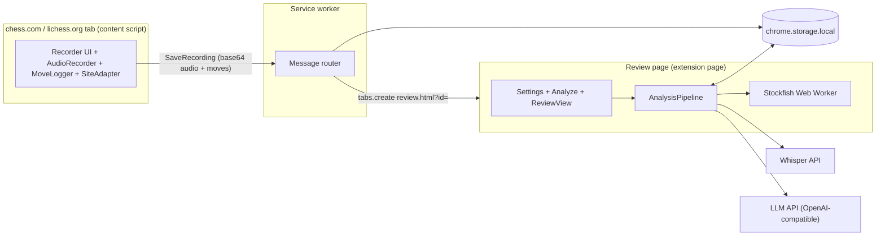
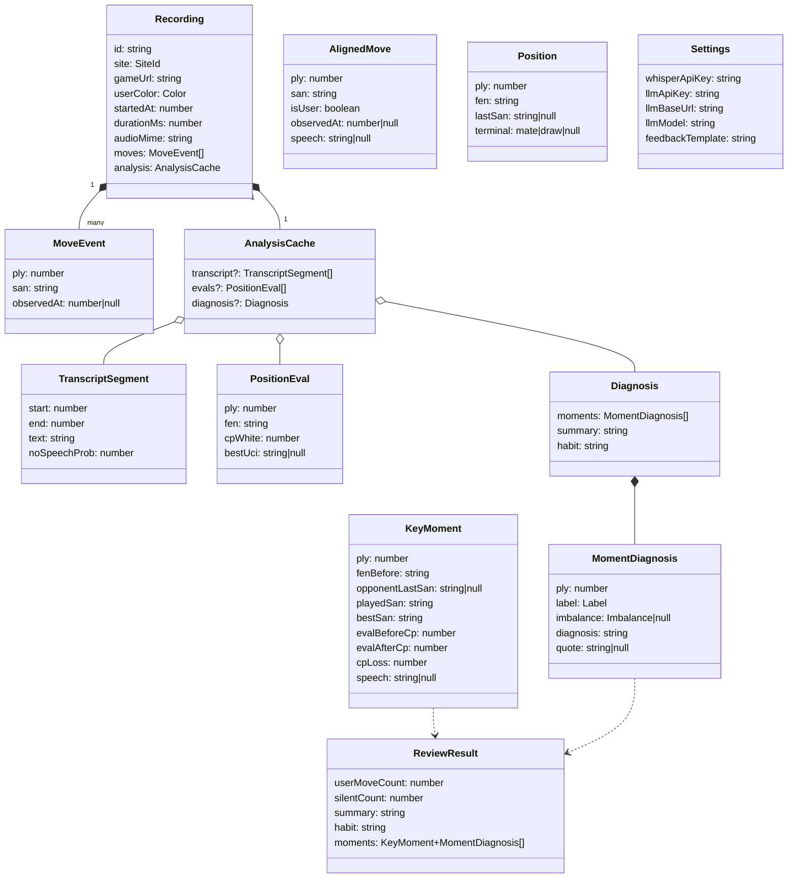
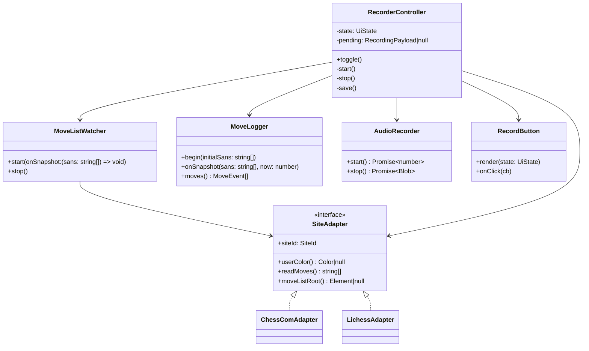
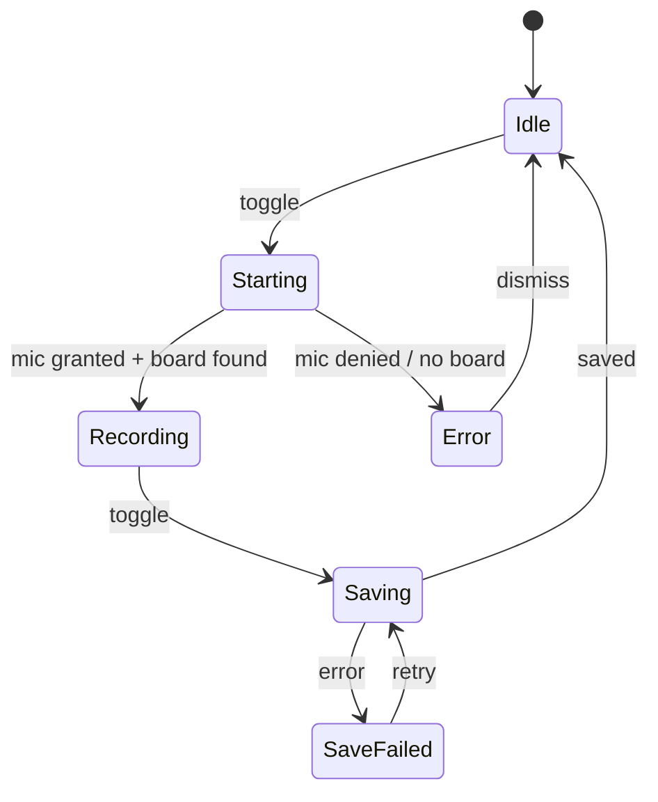
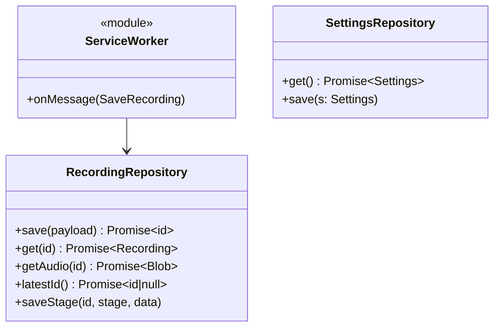
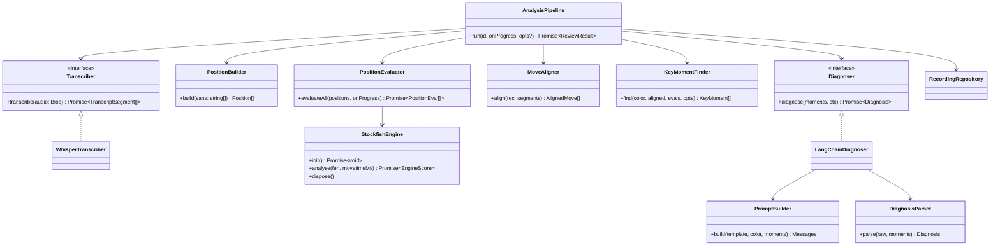
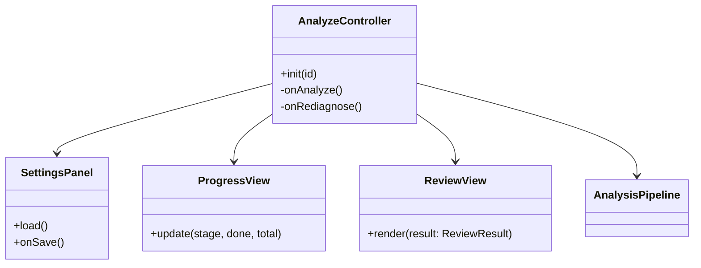
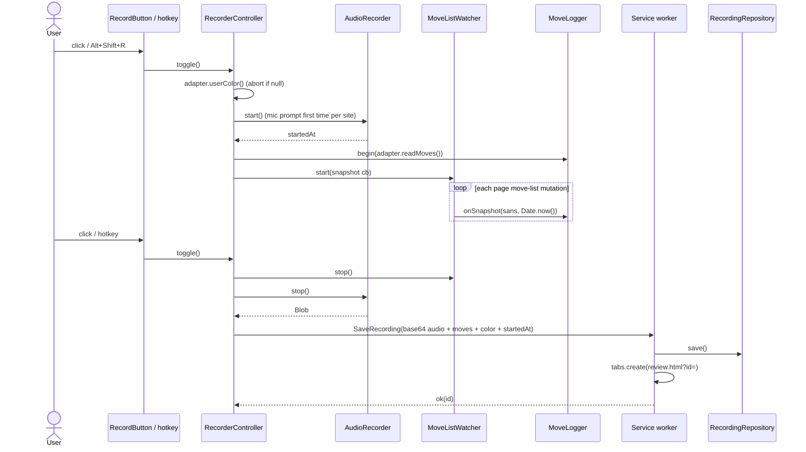
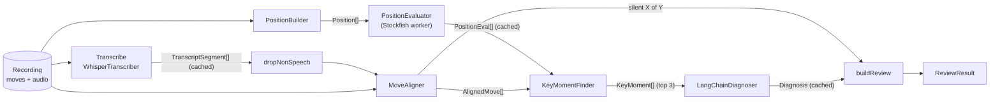

# Boardtalk: MVP architecture

Design only. Per-component detail (contracts, algorithms, edge cases, interactions) is in [`components/`](components/README.md); where it differs from this overview, `components/` wins. Diagrams are Mermaid (render natively on GitHub, GitLab, and in the VS Code / JetBrains Markdown previews). The source task is in [`task.txt`](task.txt).

## 0. Decisions to confirm

| # | Decision | Why |
|---|---|---|
| 1 | **Two API keys in settings**: `whisperApiKey` (OpenAI) and `llmApiKey`. | The task has one key, but the LLM base URL is swappable. Whisper only exists on OpenAI, so one key breaks as soon as the base URL isn't OpenAI. |
| 2 | **Arbitrary LLM base URL** uses `optional_host_permissions` and `chrome.permissions.request()` when the user clicks Save. Only `api.openai.com` is static. | MV3 can't declare hosts the user types in later. |
| 3 | **Feedback template** = the editable *framework guidance* text only. The JSON contract and the label enum stay fixed in code. | If the user could edit the output contract, the parser would break. |
| 4 | **Audio bitrate is forced to 24 kbps.** | Chrome's default is much higher. A long game would exceed Whisper's 25 MB upload cap. At 24 kbps the cap is about 2 hours. |
| 5 | **Audio is stored as base64 under its own `chrome.storage.local` key** (`audio:{id}`), not in IndexedDB. | `runtime.sendMessage` can't carry a `Blob`, so base64 is already needed on the wire. Using it for storage too means one mechanism. IndexedDB is the upgrade path. |
| 6 | **Hotkey** is a content-script `keydown` that matches `event.code === 'KeyR'`. | On macOS, Option+Shift+R produces "®", so `event.key` fails. `chrome.commands` is the alternative. |
| 7 | **Recording started mid-game**: moves already on the board get `observedAt = null`. They are excluded from key moments and from the "silent on X of Y" count. | They have no timestamp, so counting them as silent would be wrong. |
| 8 | **Key moments are picked by centipawn loss but displayed in game order.** | Reads as a narrative. |
| 9 | **Transcribe and engine evaluation run in parallel.** | They're independent (network vs CPU), so this cuts wall time. |
| 10 | **Each expensive stage is cached in the recording**: transcript, evals, diagnosis. | A bad LLM URL or a template edit shouldn't re-pay for Whisper or re-run Stockfish. |

Still open: #1 and #3.

## 1. Runtime boundaries



The hard constraint ("no help during a game") is enforced structurally:

- The content-script bundle may import only `shared/`.
- It never imports `analysis/`, chess.js, Stockfish or LangChain. Enforce this with a bundler or ESLint import restriction.
- Nothing in the content script can produce analysis, even by accident.
- The only UI it shows is the record button, with idle, recording and error states.

## 2. Module layout

```
manifest.json
public/stockfish/                   # stockfish.js lite single-thread .js + .wasm
src/
  shared/
    types.ts                        # domain types (§3)
    messages.ts                     # content -> background contract
    base64.ts
    defaultTemplate.ts              # Silman framework guidance text
    storage/RecordingRepository.ts
    storage/SettingsRepository.ts
  content/                          # may import ONLY shared/
    main.ts                         # pick adapter by hostname, hotkey, wiring
    RecorderController.ts
    AudioRecorder.ts
    MoveLogger.ts
    MoveListWatcher.ts
    RecordButton.ts                 # Shadow DOM so site CSS can't touch it
    adapters/SiteAdapter.ts  ChessComAdapter.ts  LichessAdapter.ts
  background/service-worker.ts
  review/
    review.html  main.ts
    AnalyzeController.ts  SettingsPanel.ts  ProgressView.ts  ReviewView.ts
    dom.ts                          # el() helper; textContent only, innerHTML lint-banned
  analysis/                         # imported only by review/
    AnalysisPipeline.ts
    WhisperTranscriber.ts   speech.ts
    MoveAligner.ts          PositionBuilder.ts
    StockfishEngine.ts      PositionEvaluator.ts   score.ts
    KeyMomentFinder.ts
    diagnosis/LangChainDiagnoser.ts  PromptBuilder.ts  DiagnosisParser.ts
```

## 3. Domain model



Conventions:

- `Label` = `no_structure | grabbed_material | no_plan | ignored_threat | imagined_threat | misjudged_imbalance | missed_candidate`.
- `Imbalance` = `minor_pieces | pawn_structure | files | weak_squares | space | development`. It is set only when the label is `misjudged_imbalance`.
- All evals are stored in white's POV. They convert to the user's POV only in `KeyMomentFinder`.
- Plies are 1-indexed. `Position[0]` is the start position, and the position after ply *k* is `Position[k]`. For the user's move at ply *k*, "before" is `Position[k-1]` and "after" is `Position[k]`.
- Silence stats come from `AlignedMove`, not from a separate model. Silent means `isUser && observedAt != null && speech == null`.

## 4. Classes by runtime

### 4a. Content script



| Class | Responsibility and rules |
|---|---|
| `SiteAdapter` impls | **The only place with DOM selectors.** They return normalised SAN and handle chess.com's figurine notation. `userColor()` reads board orientation. |
| `MoveListWatcher` | Waits for `moveListRoot()` to exist, because both sites mount it late. It attaches one `MutationObserver` (already batched per task, so no debounce) and a 500 ms heartbeat that re-attaches if the root is late or replaced. It emits the full SAN list plus an `observedAt` timestamp on each change, and the diffing happens in `MoveLogger`. This is robust to sites re-rendering the list. |
| `MoveLogger` | Pure. On `begin`, the existing moves get `observedAt = null`. On a snapshot, it truncates to the common prefix (this handles takebacks), then appends new moves stamped with `now`. |
| `AudioRecorder` | Calls `getUserMedia({audio:true})`, then `MediaRecorder` with `audio/webm;codecs=opus` and `audioBitsPerSecond: 24000`. `startedAt = Date.now()` is taken in the recorder's `start` event. `stop()` also stops the mic tracks. It throws a typed `MicDeniedError`. |
| `RecorderController` | Holds the state machine below. On start it refuses if `userColor()` is null. On stop it builds a `RecordingPayload` (audio base64-encoded, `moves` from the logger) and sends `SaveRecording`. If saving fails, the payload stays in `pending` and the button offers "Retry save", so a game isn't lost to a transient error. |
| `RecordButton` | Fixed-position button in a Shadow DOM. It has no analysis UI of any kind. |
| Hotkey (function in `main.ts`) | `altKey && shiftKey && code === 'KeyR'` calls `controller.toggle()`. |



### 4b. Background and storage



Storage keys:

| Key | Contents |
|---|---|
| `rec:{id}` | `Recording` (metadata, moves, `analysis` cache). No audio. |
| `audio:{id}` | Base64 string. Kept separate so reading metadata never loads megabytes. |
| `recIndex` | `id[]`, newest last. |
| `settings` | `Settings`. |

Notes:

- `SettingsRepository.get()` returns defaults, including the default template, when nothing is stored.
- Settings use `storage.local`, never `sync`, because cloud sync is out of scope and keys shouldn't leave the machine. The keys are stored in plaintext, which is acceptable for an MVP.
- The service worker has one job. It saves the recording, then calls `tabs.create({url: review.html?id=…})`. The `tabs` permission isn't needed for that.

### 4c. Analysis (pure core, I/O at the edges)



Interfaces exist only at the two network boundaries, so the pipeline can be tested with fakes. Everything else is a concrete class.

| Class | Responsibility and rules |
|---|---|
| `AnalysisPipeline` | Orchestrates the stages (§5). It skips any stage already in `recording.analysis`. `opts.redo = 'diagnosis'` powers a "Re-diagnose" button after a template edit. It reports `{stage, done, total}` progress. |
| `WhisperTranscriber` | POSTs multipart to `/v1/audio/transcriptions` with `model=whisper-1` and `response_format=verbose_json`. It fails fast with a clear message if the blob is over 25 MB. |
| `speech.ts` `dropNonSpeech()` | Pure. Drops segments with `noSpeechProb > 0.6` (constant). |
| `PositionBuilder` | Replays SAN with chess.js into `Position[]`. It stops at the first illegal SAN and returns a truncated list plus a warning. It marks `terminal` for checkmate or draw. |
| `StockfishEngine` | Wraps the Worker with a UCI handshake (`uci`, `isready`, `ucinewgame`). `analyse` sends `position fen` and `go movetime 150`, takes the last `info score` before `bestmove`, and returns the score from the side-to-move's POV plus the best UCI move. Calls are strictly serial. |
| `PositionEvaluator` | For each position: terminal positions are scored without the engine (mate = ±max, draw = 0). Otherwise it calls the engine. It normalises to white's POV through `score.ts`. |
| `score.ts` | Pure. Mate scores become ±1000 cp for loss maths (`10000 − |mateIn|`, clamped). It also has `toWhiteCp` and `toUserCp`. |
| `MoveAligner` | Pure. `segStartMs = startedAt + seg.start*1000`. A segment goes to the **first timestamped user move with `observedAt > segStartMs`**, assigned by segment start. Segments after the user's last move are dropped. Speech is joined per move. |
| `KeyMomentFinder` | Pure. Over the user's timestamped moves: `evalBefore`/`evalAfter` in the user's POV, `cpLoss = before − after`. It drops moves with `|evalBefore| > 700` or `cpLoss < 100`, sorts by loss, keeps the top 3, then sorts by ply. `bestSan` comes from `bestUci` converted with chess.js on `fenBefore`. |
| `LangChainDiagnoser` | `ChatOpenAI({configuration:{baseURL}, apiKey, model, dangerouslyAllowBrowser:true})`. This is the **only file that imports LangChain**. It makes one call, parses, and retries once on a parse failure. |
| `PromptBuilder` | System message = fixed contract + editable template. The human message is the moments as JSON. The transcript is delimited and labelled as data. |
| `DiagnosisParser` | Validates with zod after stripping code fences. It enforces three rules in code: one entry per input ply; a silent moment is forced to `no_structure` with `quote = null`; any `quote` that isn't a verbatim substring of the transcript is nulled and flagged. |

Prompt contract (fixed part):

- Choose one label per moment.
- Quote only the user's own words.
- Use nothing beyond the supplied FEN, moves, evals, engine best move and transcript.
- Make no chess claims beyond the engine's best move.
- Return the JSON shape `{moments:[{ply,label,imbalance,diagnosis,quote}], summary, habit}`.

### 4d. Review page



- `SettingsPanel` holds the keys, base URL, model and template textarea with "Reset to default". Save calls `chrome.permissions.request` for the base URL origin, then `SettingsRepository.save`.
- `ReviewView` shows the summary and habit, "silent on X of Y of your moves", then each key moment. Each moment has the move played, the eval change, what the user said, the label with its diagnosis, and the engine's preferred move. All text goes through `el()` and `textContent`.
- `AnalyzeController` loads `?id=`, falling back to `latestId()`. If a cached `diagnosis` exists, it renders immediately without spending API calls.

## 5. Flows

### Recording



### Analysis



- **Parallel stages:** Transcribe and Evaluate run concurrently with `Promise.all`.
- **Cheap stages:** Align and KeyMoments are deterministic and instant, so they're recomputed rather than cached.
- **No key moments:** If `KeyMomentFinder` returns nothing, the LLM call is skipped. The review shows "no significant mistakes found" and the silence stats.

## 6. Manifest essentials

- `permissions`: `storage`, `unlimitedStorage`.
- `host_permissions`: `https://api.openai.com/*`.
- `optional_host_permissions`: `https://*/*`, `http://localhost/*`. These are requested per origin when the user saves settings.
- `content_scripts`: matches `https://www.chess.com/*` and `https://lichess.org/*`, top frame only, `document_idle`.
- `background.service_worker`: module.
- `content_security_policy.extension_pages`: `script-src 'self' 'wasm-unsafe-eval'; object-src 'self'`.
- No `tabs`, `activeTab` or `web_accessible_resources` are needed.

The `manifest.json` in this repo points at `.ts` source paths. The bundler (not chosen yet) must rewrite them to built output.

## 7. Failure handling (MVP level)

| Failure | Behaviour |
|---|---|
| Mic denied, or no board found | Button shows an error state and recording doesn't start. |
| Selectors have drifted, so 0 moves were captured | The recording still saves. The review page says "no moves captured, the site adapter may be out of date". This is the main long-term maintenance risk. |
| Save to background fails | Payload is held in memory with a "Retry save" button. |
| Illegal SAN during replay | Analysis truncates at the last legal move and shows a notice. |
| Whisper 401, 413 or network error | The stage fails with a readable message. Cached stages are kept. |
| LLM returns invalid JSON | One retry, then fail with a message. Transcript and evals stay cached. |
| Review tab closed mid-analysis | Work is lost, except stages that finished and were cached. |

## 8. Testing seams

- **Pure unit tests (vitest):** `MoveLogger`, `MoveAligner`, `KeyMomentFinder`, `score`, `speech`, `PositionBuilder`, `PromptBuilder`, `DiagnosisParser`. The aligner and finder carry the most logic, so they get the most cases. Cases include a mid-game start, a user playing black, speech after the last move, mate scores, and a decided position.
- **Adapters:** saved HTML fixtures per site, run in jsdom. When a selector breaks, you update the fixture and the one adapter.
- **Pipeline:** integration test with fake `Transcriber`, `Diagnoser` and engine.

## 9. Spikes to run first, in risk order

1. **Mic in the content script** on both sites. Check for a Permissions-Policy block and the per-site prompt.
2. **Adapter selectors:** move list, board orientation, and SAN extraction from chess.com's figurine notation.
3. **Stockfish lite WASM** in an extension-page Worker under the CSP. Measure the depth reached in 150 ms and the total time for about 100 positions.
4. **Clap test for clock alignment.** Record claps at known moves and confirm the Whisper segment times line up with the epoch move timestamps.
5. **LLM path:** LangChain bundle size, and the optional-permission flow against a non-OpenAI base URL.

## 10. Other things to know

- **Licensing:** Stockfish is GPL-3.0. If you publish to the Chrome Web Store, you'll need GPL compliance (a source offer). Pin the exact version.
- **Privacy:** audio goes to OpenAI. FENs and transcripts go to whatever LLM host is configured. The settings page should say so.
- **Not designed, since out of scope:** a recordings list, deleting old recordings (storage grows unbounded), cancelling an in-flight analysis, and recovering a recording if the tab closes or navigates before Stop. The last one is likely to bite, for example on a lichess rematch. The upgrade path is to stream `MediaRecorder` chunks to the background every ~10 s. It would slot in behind `AudioRecorder` without changing the other classes.
