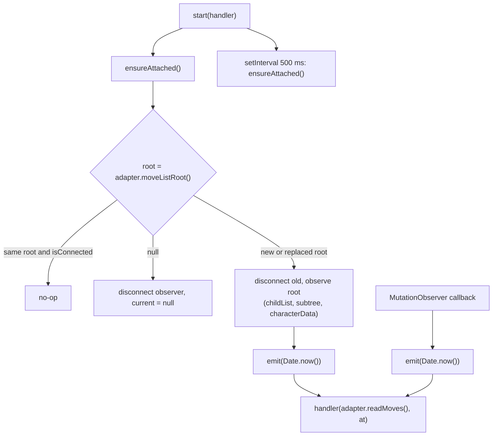

# 01. Move capture

## Purpose

Turn the site's live move list into a timestamped list of SAN moves, without any chess logic. All site-specific DOM knowledge is isolated in the adapters. Everything downstream is pure and site-agnostic.

## Contract

```ts
// content/adapters/SiteAdapter.ts
interface SiteAdapter {
  readonly siteId: SiteId;
  userColor(): Color | null;        // board orientation; null = no board on this page
  readMoves(): string[];            // full current list, normalised SAN, never throws
  moveListRoot(): Element | null;   // element to observe; null if not mounted yet
}

// content/adapters/normalizeSan.ts   (pure, shared by both adapters)
function normalizeSan(raw: string): string | null;   // null = not a move token

// content/MoveListWatcher.ts
type SnapshotHandler = (sans: string[], observedAt: number) => void;
class MoveListWatcher {
  constructor(adapter: SiteAdapter);
  start(handler: SnapshotHandler): void;
  stop(): void;
}

// content/MoveLogger.ts   (pure: never reads the clock)
class MoveLogger {
  begin(initialSans: string[]): void;
  onSnapshot(sans: string[], observedAt: number): void;
  moves(): MoveEvent[];
}
```

## Collaborators

| Who | Calls | Gets |
|---|---|---|
| `RecorderController` | `adapter.userColor()`, `adapter.readMoves()` | colour, initial move list |
| `RecorderController` | `watcher.start(h)`, `watcher.stop()` | nothing (sync) |
| `RecorderController` | `logger.begin(sans)`, `logger.moves()` | final `MoveEvent[]` |
| `MoveListWatcher` | `adapter.moveListRoot()`, `adapter.readMoves()` | element, SAN list |
| Handler (wired by controller) | `logger.onSnapshot(sans, at)` | nothing |

## Behaviour

### What the adapters do

Each adapter walks its site's move list in DOM order, turns each move element into text, and passes it through `normalizeSan`. Anything DOM-specific lives in the adapter. For example, chess.com renders pieces as figurine icons, so the adapter converts the icon to a letter before calling `normalizeSan`.

`normalizeSan` rules:

| Raw token | Result |
|---|---|
| `♘f3` or icon + `f3` | `Nf3` (figurine to letter) |
| `0-0`, `0-0-0` | `O-O`, `O-O-O` |
| `12.`, `12…` (move numbers) | `null` |
| `1-0`, `0-1`, `1/2-1/2`, `*` | `null` |
| `Nf3!`, `e4?!` | `Nf3`, `e4` (annotations stripped) |
| clock text, NBSP, extra whitespace | trimmed or `null` |
| `e8=Q+`, `Qxe7#` | unchanged (check and mate marks kept) |

### `MoveListWatcher` lifecycle



- **One observer, on the move list only.** The clock and board mutate constantly, but the move list changes only on a move.
- **No debounce.** `MutationObserver` already batches records into one callback per task. A `requestAnimationFrame` debounce would stop firing in a hidden tab, so none is used.
- **The heartbeat covers two cases.** Both sites mount the move list late, and a site can replace the node mid-game. In either case the next tick re-attaches and emits a snapshot. The cost is up to 500 ms of timestamp lateness for the first move only.
- `emit` wraps the handler in `try/catch` and logs. A broken selector must never take the page down.
- `stop()` clears the interval, disconnects, and nulls the handler.

### `MoveLogger` algorithm

State: `list: MoveEvent[]`.

- `begin(initial)`: `list = initial.map((san, i) => ({ ply: i + 1, san, observedAt: null }))`.
- `onSnapshot(sans, at)`:
  1. If `sans.length < list.length`, return. A shorter snapshot is treated as a transient re-render and **never truncates**.
  2. `k` = length of the common prefix of `list.map(m => m.san)` and `sans`.
  3. If `k < list.length`, the list diverged (takeback and replay), so `list.length = k`.
  4. For `i` from `k` to `sans.length - 1`, push `{ ply: i + 1, san: sans[i], observedAt: at }`.

| Case | Snapshot sequence | Resulting list |
|---|---|---|
| Join mid-game | `begin([e4, e5, Nf3])`, then `[e4, e5, Nf3, Nc6] @T1` | `e4:null, e5:null, Nf3:null, Nc6:T1` |
| Burst | `[…, Nc6, Bb5, a6] @T2` in one go | `Bb5:T2, a6:T2` (same stamp) |
| Identical snapshot (clock tick) | same list | no-op |
| Transient blank | `[]` | ignored |
| Takeback then different move | list `[…, Bb5, a6]`, snapshot `[…, Bb5]` (ignored), then `[…, Bb5, Nf6] @T5` | `a6` dropped, `Nf6:T5` |

## Edge cases

- **Recording starts before the first move.** The root may not exist, so the heartbeat waits. `begin([])` gives an empty list, and the first snapshot adds ply 1.
- **User flips the board mid-game.** The colour is read once at start and is not updated.
- **Player browses move history.** The move list DOM doesn't change (only a highlight moves), so nothing is logged.
- **Post-game analysis mode.** The list can gain engine variations on some sites. Out of scope for the MVP. Users stop the recording first.
- **Selectors have drifted.** `readMoves()` returns `[]` and nothing is logged. The save still succeeds and the controller warns (see 03).

## Errors

The adapter methods and `normalizeSan` never throw. Failures show up as `null`, `[]` or `false`. The only visible symptom is "0 moves captured".

## Tests

- **`normalizeSan`:** a table test of every row above, plus garbage input.
- **Adapters:** saved HTML fixtures per site, run in jsdom. Cases: live game as white, live as black (flipped), castling, promotion, a mate, and a figurine-rendered list on chess.com. Assert `userColor()` and `readMoves()`.
- **`MoveListWatcher`:** jsdom with fake timers. Mutate the DOM and assert the handler calls, the late-mount re-attach, and the replaced-root re-attach.
- **`MoveLogger`:** the case table above, one test per row.
