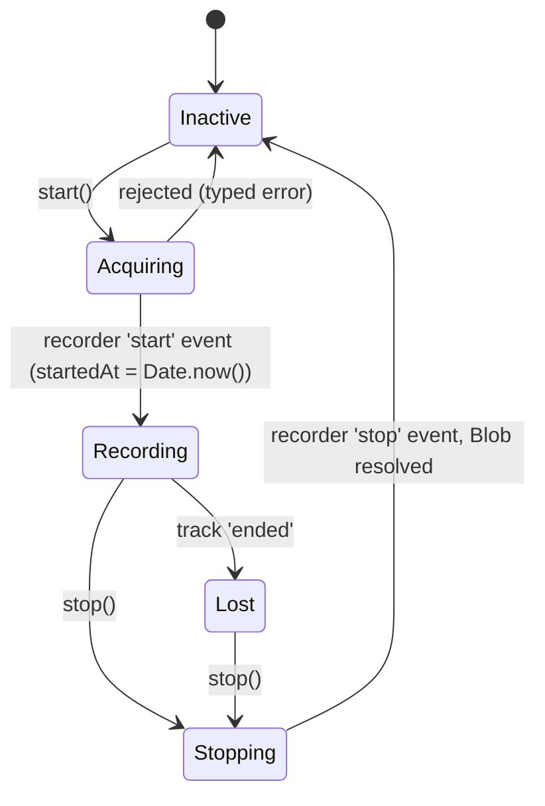

# 02. Audio capture

## Purpose

Record the microphone to a single compressed blob and report the exact epoch-ms instant recording started. That timestamp is the only link between speech and moves.

## Contract

```ts
// content/AudioRecorder.ts
class MicDeniedError extends Error {}          // permission blocked or dismissed
class NoMicError extends Error {}              // no input device
class UnsupportedAudioError extends Error {}   // audio/webm;codecs=opus unavailable

class AudioRecorder {
  start(): Promise<number>;             // resolves with startedAt (epoch ms)
  stop(): Promise<Blob>;                // flushes, stops recorder AND mic tracks
  onLost(cb: () => void): void;         // input device ended while recording
}
```

## Collaborators

| Who | Calls | Gets |
|---|---|---|
| `RecorderController` | `start()`, `stop()`, `onLost(cb)` | `startedAt`, `Blob`, a lost-mic signal |
| `AudioRecorder` | `navigator.mediaDevices.getUserMedia`, `MediaRecorder` | stream, chunks |

It has no other collaborators. It knows nothing about moves, storage or messaging.

## Behaviour



**`start()`**
1. Reject with `UnsupportedAudioError` if `!MediaRecorder.isTypeSupported('audio/webm;codecs=opus')`.
2. `getUserMedia({ audio: { channelCount: 1, noiseSuppression: true, echoCancellation: true } })`. Echo cancellation helps because the chess site plays move sounds out of the speakers.
3. Map errors: `NotAllowedError` to `MicDeniedError`, `NotFoundError` to `NoMicError`, anything else is rethrown.
4. `new MediaRecorder(stream, { mimeType, audioBitsPerSecond: 24000 })`.
5. Collect `dataavailable` chunks into an array. Call `recorder.start(10_000)`. The 10 s timeslice keeps memory in small pieces and is the hook for streaming chunks later.
6. Resolve from the recorder's `onstart` with `Date.now()`. The timestamp is taken **in the event**, not when `start()` was called, so permission-prompt time is excluded.
7. Attach `track.onended` to fire `onLost`.

**`stop()`** calls `recorder.stop()`, waits for the `stop` event, stops every track (so the browser's recording indicator turns off), and resolves `new Blob(chunks, { type: mimeType })`.

**Size budget.** 24 kbps is 3,000 B/s, about 10.8 MB per hour. Whisper's 25 MB cap is therefore about 2.3 hours.

## Edge cases

| Case | Behaviour |
|---|---|
| Permission prompt left open for a long time | `start()` stays pending and the controller stays in `starting`. Moves made meanwhile are never logged. `logger.begin` runs after `start()` resolves, so they become `observedAt = null`. |
| Mic unplugged mid-game | `MediaRecorder` stops itself. `onLost` fires, the controller shows a warning on the button, and move logging continues. `stop()` still resolves with the audio recorded so far. |
| Tab hidden or throttled | `MediaRecorder` is unaffected. |
| Site sends a Permissions-Policy that blocks the mic | `getUserMedia` rejects with `NotAllowedError`, which looks like a denial. This is why spike 1 in `architecture.md` exists. |
| `stop()` called twice | The second call resolves with the same blob. |

## Errors

Only the three typed errors above, thrown from `start()`. `stop()` doesn't throw. The controller turns each error into a message (see 03).

## Tests

- **Unit:** fake `MediaRecorder` and `getUserMedia`. Assert that `startedAt` comes from the start event, that tracks are stopped, that each error is mapped correctly, and that `onLost` fires.
- **Manual (spike):** on both sites, check that the permission prompt appears, a 60 s recording plays back, and the file is at or under about 180 KB.
