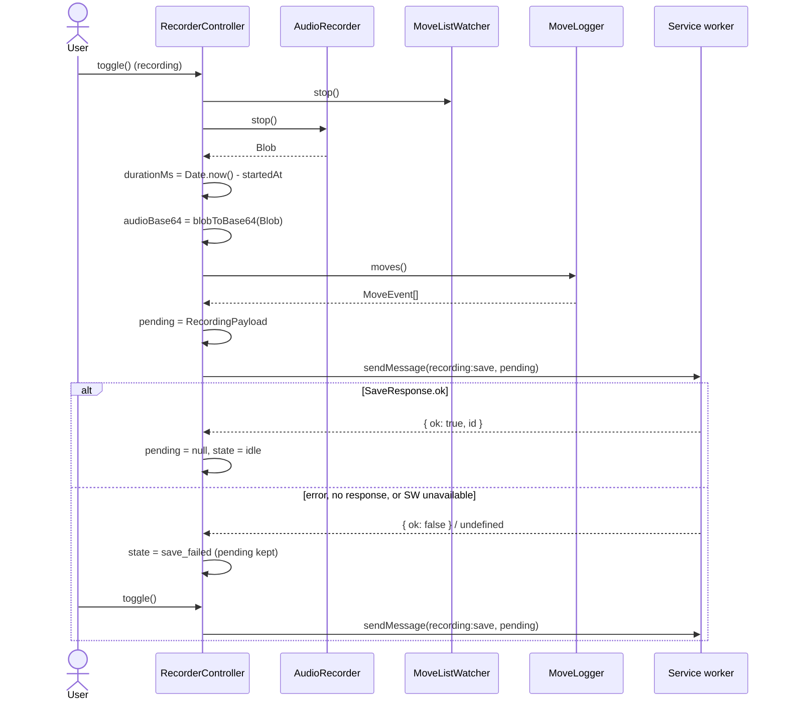

# 03. Recorder controller

## Purpose

The one object in the content script that knows the whole recording lifecycle. It owns the state machine, wires audio and move capture together, builds the payload, and talks to the background worker. It also owns the only UI in the page.

## Contract

```ts
// content/RecorderController.ts
class RecorderController {
  constructor(adapter, audio, watcher, logger, button);
  toggle(): void;          // click or hotkey; behaviour depends on state
}

// content/RecordButton.ts
type UiState = 'idle' | 'starting' | 'recording' | 'saving' | 'save_failed' | 'error';
class RecordButton {
  render(state: UiState, detail?: { message?: string; warning?: boolean }): void;
  onClick(cb: () => void): void;
}

// content/main.ts   (wiring + hotkey, not a class)
// document keydown: altKey && shiftKey && code === 'KeyR' && !repeat  ->  preventDefault(); controller.toggle()
```

## Collaborators

| Controller calls | For |
|---|---|
| `adapter.userColor()`, `adapter.readMoves()` | colour check at start, initial move list |
| `audio.start()` / `audio.stop()` / `audio.onLost()` | mic lifecycle |
| `logger.begin()` / `logger.moves()` | move list |
| `watcher.start(h)` / `watcher.stop()` | live snapshots (`h` forwards to `logger.onSnapshot`) |
| `blobToBase64()` (shared) | encode audio for messaging |
| `chrome.runtime.sendMessage` | hand off to the service worker |
| `button.render()` | the only visible output |

## Behaviour

### State machine

| State | Event | Guard | Actions | Next |
|---|---|---|---|---|
| idle | TOGGLE | `userColor() !== null` | render(starting), `audio.start()` | starting |
| idle | TOGGLE | `userColor() === null` | render(error, "Open a game first") | error |
| starting | audio resolved | none | `logger.begin(adapter.readMoves())`, `watcher.start(...)` | recording |
| starting | audio rejected | none | render(error, message for the error type) | error |
| recording | TOGGLE | none | `watcher.stop()`, `blob = await audio.stop()`, build payload, send | saving |
| recording | audio `onLost` | none | render(recording, warning: "Mic lost") | recording |
| saving | response `ok` | none | `pending = null`, flash "Saved" for 2 s | idle |
| saving | response fail or none | none | keep `pending`, render(save_failed) | save_failed |
| save_failed | TOGGLE | none | re-send `pending` | saving |
| error | TOGGLE or 4 s timeout | none | none | idle |
| starting, saving | TOGGLE | none | **ignored** | unchanged |

Order matters in the `starting` to `recording` step: `audio.start()` resolves **first**, then `logger.begin(...)`. Everything already on the board at that instant is "pre-existing" (`observedAt = null`). It also happened before the mic was live, so it correctly has no speech.

### Button appearance

A single `<button>` in a Shadow DOM. Styling is the minimum needed to stay visible on a busy page: fixed position, system font, a border. State is carried by the label text, not by colour or icons.

| State | Label |
|---|---|
| idle | "Record thinking" |
| starting | "Waiting for mic…" (disabled) |
| recording | "● Recording  mm:ss" (plus " (mic lost)" if the input device ended) |
| saving | "Saving…" (disabled) |
| save_failed | "Retry save" |
| error | the message, for 4 s |

The recording timer is the only thing shown in-game besides the button. No move or position information is shown, ever.

### Save and failure sequence



`RecordingPayload` fields: `site` (`adapter.siteId`), `gameUrl` (`location.href`), `userColor` (read at start), `startedAt`, `durationMs`, `audioMime`, `audioBase64`, `moves`.

## Edge cases

- **Zero moves captured at stop:** the save still happens, because the audio may still be useful. The "Saved" flash becomes "Saved, but no moves were detected (the site layout may have changed)".
- **Page navigates away while recording:** the recording is lost. This is a known MVP limitation (see `architecture.md` §10).
- **Hotkey pressed while typing in a field:** `Alt+Shift+R` is not a text-entry chord, so no special handling. `event.repeat` is ignored so holding the keys doesn't toggle repeatedly.
- **`sendMessage` rejects with "Extension context invalidated"** (the extension was reloaded): treated like any other save failure, and `pending` is kept.
- **`sendMessage` size:** a 2 h recording is about 22 MB of base64, which is under Chrome's 64 MiB message limit.

## Errors

| Source | Button message |
|---|---|
| `MicDeniedError` | "Microphone blocked. Allow it for this site and try again." |
| `NoMicError` | "No microphone found." |
| `UnsupportedAudioError` | "This browser can't record Opus audio." |
| `userColor() === null` | "Open a game first." |
| other error from `start()` | "Couldn't start recording." |

## Tests

- **State machine:** drive `toggle()` with fake collaborators. Assert every row of the table, including the ignored toggles.
- **Order:** assert `audio.start()` resolves before `logger.begin`, using a deferred promise.
- **Save failure:** make the fake `sendMessage` return `{ ok: false }`, then assert that a retry re-sends the same payload.
- **Hotkey:** dispatch `KeyboardEvent`s with `altKey`, `shiftKey` and `code: 'KeyR'`, and with `repeat: true`.
