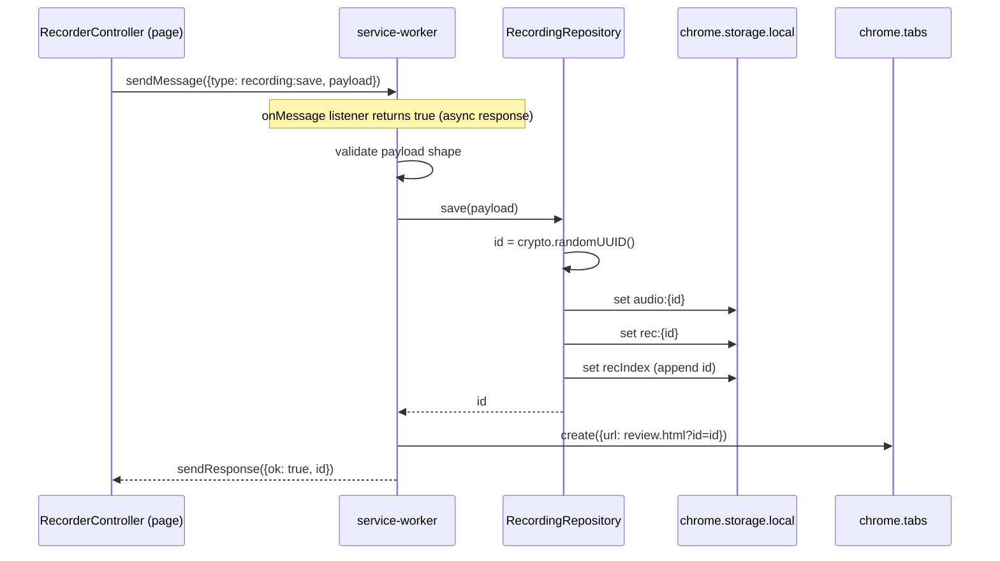

# 04. Persistence and messaging

## Purpose

Move a finished recording from the page to durable storage and open the review page. Provide the two repositories the rest of the extension uses to read and write data.

## Contract

```ts
// shared/messages.ts
type Message = { type: 'recording:save'; payload: RecordingPayload };
type SaveResponse = { ok: true; id: string } | { ok: false; error: string };

// shared/storage/RecordingRepository.ts
type RecordingMeta = Omit<Recording, 'analysis'>;
class RecordingRepository {
  save(payload: RecordingPayload): Promise<string>;                 // returns new id
  get(id: string): Promise<Recording | null>;                       // meta + assembled analysis
  getAudio(id: string): Promise<Blob>;
  latestId(): Promise<string | null>;
  saveStage<K extends keyof AnalysisCache>(id, stage: K, data: NonNullable<AnalysisCache[K]>): Promise<void>;
}

// shared/storage/SettingsRepository.ts
class SettingsRepository {
  get(): Promise<Settings>;          // stored values merged over defaults
  save(s: Settings): Promise<void>;  // trims and normalises first
}

// shared/base64.ts
function blobToBase64(blob: Blob): Promise<string>;          // raw base64, no "data:" prefix
function base64ToBlob(b64: string, mime: string): Blob;
```

## Collaborators

| Who | Calls | Notes |
|---|---|---|
| `RecorderController` | `chrome.runtime.sendMessage(Message)` | one message type in the whole extension |
| `service-worker` | `RecordingRepository.save`, `chrome.tabs.create` | the SW's only job |
| `AnalyzeController` | `RecordingRepository.get`, `SettingsRepository.get` | review page |
| `AnalysisPipeline` | `RecordingRepository.get`, `getAudio`, `saveStage` | per stage |
| `SettingsPanel` | `SettingsRepository.get`, `save` | settings form |

## Behaviour

### Storage layout (`chrome.storage.local`)

| Key | Value | Written by | Read by |
|---|---|---|---|
| `rec:{id}` | `RecordingMeta` (no audio, no analysis) | `save` | `get` |
| `audio:{id}` | base64 string | `save` | `getAudio` |
| `analysis:{id}:transcript` | raw `TranscriptSegment[]` | `saveStage` | `get` |
| `analysis:{id}:evals` | `PositionEval[]` | `saveStage` | `get` |
| `analysis:{id}:diagnosis` | `Diagnosis` | `saveStage` | `get` |
| `recIndex` | `string[]` of ids, newest last | `save` | `latestId` |
| `settings` | `Settings` | `SettingsRepository.save` | `SettingsRepository.get` |

Why **one key per analysis stage**: transcribe and evaluate run in parallel, and both persist their result. If both did read-modify-write on a single `rec:{id}` object, one write would overwrite the other. Separate keys remove the race without a lock.

Why audio is a **separate key**: reading `rec:{id}` for the review header must not load megabytes.

### Save sequence



- **Write order is audio, then meta, then index.** A crash mid-save can leave an orphaned audio blob but never an index entry that points at missing data.
- **The tab is created after the save succeeds.** If `tabs.create` itself fails, the recording is already safe, so the response is still `ok` and the failure is logged. The data is recoverable.
- **Validation** is a cheap shape check: required fields present, `moves` is an array, `audioBase64` is a non-empty string. Only our own content script can send this message (no `externally_connectable`), so this guards bugs, not attackers.
- **Service-worker lifetime:** an in-flight message keeps the worker alive while the listener's async work runs. Writing about 15 MB to storage is well inside that.
- **`get(id)`** makes one `storage.local.get([rec, transcript, evals, diagnosis keys])` call and assembles `analysis` from whichever keys exist. It returns `null` if `rec:{id}` is missing.

### Settings

- **Defaults:** empty keys, `llmBaseUrl = "https://api.openai.com/v1"`, a chosen default model name, `feedbackTemplate = DEFAULT_FEEDBACK_TEMPLATE`.
- **`get()`** is `{ ...DEFAULTS, ...stored }`, so a field added in a later version appears with its default.
- **`save()` normalises:** trim strings, strip trailing `/` from the base URL, and reject any base URL that isn't `https://` or `http://localhost`. It throws a readable error that the panel shows inline.
- Always `storage.local`, never `sync`. Keys are plaintext, which is accepted for the MVP (noted in `architecture.md`).

## Edge cases

| Case | Behaviour |
|---|---|
| Storage quota exceeded | `set` rejects, the SW returns `{ ok: false, error }`, and the page keeps `pending` for retry. `unlimitedStorage` makes this unlikely. |
| Two saves at once | Not expected (one recording at a time). The index append is the only shared write, and it is done in a single `get`-then-`set` inside one SW event. |
| SW killed mid-save | The page gets no response and treats it as a failure. A retry creates a fresh id. A leftover orphan audio key is harmless (cleanup is out of scope). |
| Review opened with an unknown id | `get` returns `null`. The page shows "Recording not found". |

## Errors

The SW returns `{ ok: false, error: string }` and never throws across the message boundary. Repositories reject with plain `Error`. The review page's callers map these (see 05).

## Tests

- **Repositories:** a fake `chrome.storage.local` (in-memory map). Cover the save write order, `get` assembly with partial analysis, `latestId`, and settings merge and normalisation.
- **`base64`:** round-trip a few-MB random blob, and check it doesn't overflow the stack (no `String.fromCharCode(...bigArray)`).
- **Service worker:** call the message handler with a fake repo and a fake `tabs.create`. Assert the tab URL, the success response, and the failure response.
