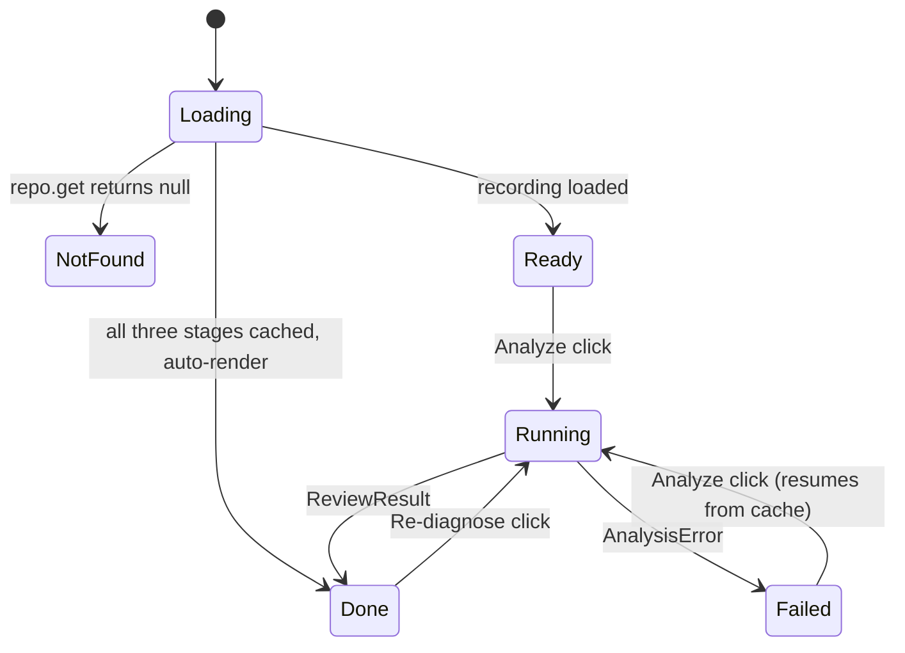
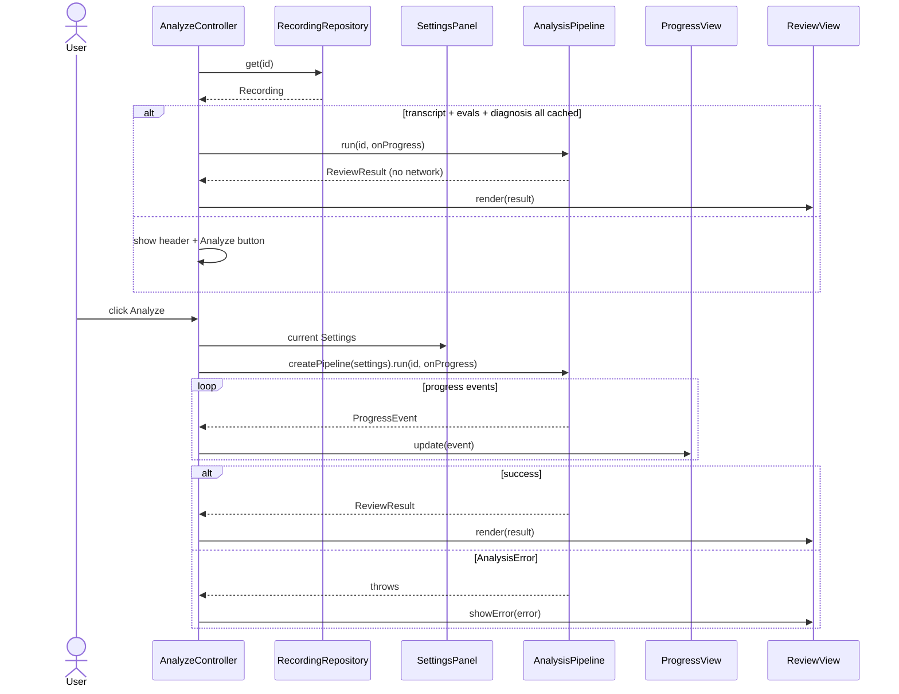

# 05. Review shell

## Purpose

The extension page that opens after recording. It loads the recording, edits settings, runs the pipeline with a progress display, and renders the result. It contains no analysis logic. It translates between the user and `AnalysisPipeline`.

## UI scope

**No fancy UI.** The page is plain semantic HTML, with the final analysis as an ordinary HTML document.

- No framework, no CSS framework, no icon set, no charts, no board rendering, no coloured chips.
- Use native elements: `<h1>`-`<h3>`, `<p>`, `<dl>`, `<details>`, `<form>`, `<label>`, `<input>`, `<textarea>`, `<button>`.
- Browser default styling. The only CSS allowed is a handful of rules in a `<style>` block in `review.html` for a readable line length (for example `body { max-width: 42rem; margin: 2rem auto; font-family: system-ui; }`). No separate stylesheet.
- State is conveyed in words, not colour or icons.
- `el()` still exists, because it is the `textContent`-only way to build elements without `innerHTML`.

## Contract

```ts
// review/main.ts: composition root, not a class
//   id = URL ?id=  ??  await repo.latestId()
//   builds SettingsPanel, ProgressView, ReviewView, AnalyzeController
//   createPipeline(settings: Settings): AnalysisPipeline   // wires real Whisper/Stockfish/LangChain

class AnalyzeController {
  constructor(settings: SettingsPanel, progress: ProgressView, view: ReviewView,
              createPipeline: (s: Settings) => AnalysisPipeline, repo: RecordingRepository);
  init(id: string): Promise<void>;
  // private: onAnalyze(), onRediagnose()
}

class SettingsPanel  { load(): Promise<void>; onSave(): Promise<void>; }
class ProgressView   { update(e: ProgressEvent): void; reset(): void; }
class ReviewView     { render(r: ReviewResult): void; showError(e: AnalysisError | Error): void; }

// review/dom.ts
function el(tag: string, props?: { text?: string; className?: string }, children?: Array<HTMLElement | string>): HTMLElement;
// textContent only. innerHTML is banned in this repo (lint rule).
```

The pipeline is constructed per run by `createPipeline(settings)`, because the Whisper and LLM clients need the current settings.

## Collaborators

| Who | Calls | Gets |
|---|---|---|
| `AnalyzeController` | `repo.get(id)` | `Recording` (with cached analysis) |
| `AnalyzeController` | `settingsRepo.get()` (via `SettingsPanel`) | `Settings` |
| `AnalyzeController` | `createPipeline(settings).run(id, onProgress, opts)` | `ReviewResult` or a thrown `AnalysisError` |
| `AnalyzeController` | `progress.update(event)` / `view.render(result)` / `view.showError(e)` | none |
| `SettingsPanel` | `settingsRepo.save(s)`, `chrome.permissions.request` | save result, permission result |

## Behaviour

### Controller states



### Load and analyze



- Auto-render of a fully cached recording costs no API calls, since every network stage is skipped. The pipeline still recomputes the cheap stages.
- **Failed then Analyze** resumes. Stages that finished (and were cached) are skipped, so a wrong LLM URL doesn't re-run Whisper or Stockfish.
- **Re-diagnose** calls `run(id, onProgress, { redo: 'diagnosis' })`. It is shown after a template or model change and re-spends only the LLM call.

### `SettingsPanel`

| Field | Control | Validation on Save |
|---|---|---|
| Whisper API key (OpenAI) | password input | none (checked lazily by the pipeline) |
| LLM API key | password input | none |
| LLM base URL | text | `https://…` or `http://localhost…`; trailing `/` stripped |
| Model name | text | non-empty |
| Feedback template | textarea + "Reset to default" | none |

The panel is a plain `<form>` of `<label>` and `<input>` pairs inside a `<details><summary>Settings</summary>` element.

On **Save**: `SettingsRepository.save()` (which normalises), then `chrome.permissions.request({ origins: [origin + '/*'] })` for the base URL's origin, unless `api.openai.com` (static) or already granted. A denial shows an inline error: "Boardtalk can't reach <origin> without permission."

Keys are validated **lazily by the stage that needs them**. The pipeline throws `AnalysisError('transcribe', 'config')` if the Whisper key is empty and no transcript is cached. This avoids duplicating "which fields does this run need" logic in the UI.

### `ProgressView`

One line of plain text, for example `Transcribe: done · Evaluate: 54/84 · Diagnose: waiting`. Each stage reads as one of waiting, running (with `done/total` where known), done, cached, skipped or failed. No bar and no icons. It consumes `ProgressEvent` (see 10).

### `ReviewView` markup

The result is a plain HTML document body. Rough shape (every text node is set with `textContent`):

```html
<h1>Boardtalk</h1>
<p>chess.com · 19 Oct 2026 · 42 moves · 31:08</p>
<details><summary>Settings</summary> <form>…</form> </details>
<button>Analyze</button>
<p>Transcribe: done · Evaluate: 54/84 · Diagnose: waiting</p>

<h2>Summary</h2>
<p>Silent on 11 of 21 of your moves.</p>
<p>…2-3 sentences…</p>
<h2>Habit to practise</h2>
<p>…one habit…</p>

<h2>Key moments</h2>
<h3>Move 14… Nxe5?</h3>
<dl>
  <dt>Eval</dt>             <dd>+0.3 → −3.1 (−3.4)</dd>
  <dt>Label</dt>            <dd>Ignored opponent's threat</dd>
  <dt>You said</dt>         <dd>"I'll just take the pawn"</dd>
  <dt>Diagnosis</dt>        <dd>…</dd>
  <dt>Engine preferred</dt> <dd>Qd2</dd>
</dl>
```

- Move heading: `moveNumber = ceil(ply / 2)`. White shows `14.`, black shows `14…`.
- Eval: `cp / 100` to one decimal with a sign, in the **user's** point of view. The change is `after - before`.
- Silent moment: the "You said" value is "(silent)".
- Label text comes from a display-name map (`review/labels.ts`): `no_structure` is "No structure", `ignored_threat` is "Ignored opponent's threat", `imagined_threat` is "Imagined threat", and so on. For `misjudged_imbalance` the text appends the imbalance, e.g. "Misjudged imbalance: weak squares".
- If `warnings` is non-empty, render them as a `<ul>` under a "Notes" `<h2>` above the summary.
- If there are no key moments: a single paragraph, "No move lost 1.0 or more in a position that was still undecided.", plus the silence line. There is no summary or habit.
- **Every string comes from `el()` and `textContent`.** This includes the model's text and the user's transcript.

### Error messages (`ReviewView.showError`)

| `AnalysisError.kind` | Message | What the user can do |
|---|---|---|
| `config` | "<field> is missing." | Open Settings |
| `auth` | "The API rejected the key." | Fix the key |
| `too_large` | "Audio is over 25 MB; Whisper can't take it." | Nothing in the MVP |
| `network` | "Request failed (<status or reason>)." | Retry |
| `permission` | "No permission to reach <origin>." | Re-save Settings |
| `parse` | "The model's reply wasn't valid." plus a collapsible raw excerpt as plain text | Retry or Re-diagnose |
| `engine` | "The chess engine failed to start." | Reload the page |
| `unsupported` | "This game couldn't be replayed (variants aren't supported)." | None |

Any non-`AnalysisError` is shown as "Unexpected error" with its `message`.

## Edge cases

- **Review page reopened later:** `?id=` still loads. Cached results render immediately.
- **No `?id=`:** fall back to `latestId()`. If there is none, show "No recordings yet."
- **User edits settings during a run:** the run keeps the settings it started with. The edit applies to the next run.
- **Tab closed mid-run:** work is lost except stages already persisted.

## Tests

- **Controller:** fake pipeline and repos. Cover the state transitions, the cached auto-render, and resume after failure.
- **`ReviewView`:** jsdom. Render a result containing `` in the transcript and the diagnosis. Assert it appears as text and that no element was created.
- **Formatting helpers:** move label (white and black) and eval formatting.
