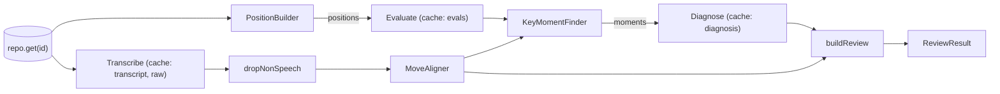
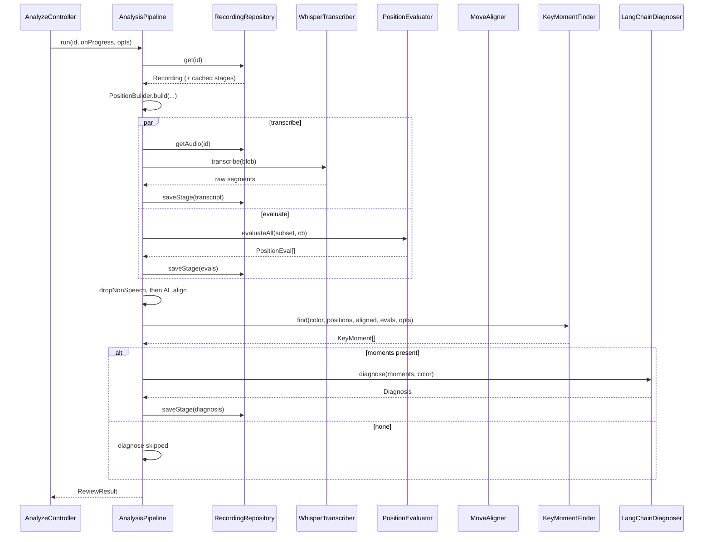

# 10. Pipeline

## Purpose

Run the analysis stages in the right order and concurrency, cache the expensive results, report progress, and turn failures into one typed error. It contains no chess or LLM logic of its own. It sequences the components in 06 to 09.

## Contract

```ts
// analysis/errors.ts   (Stage is imported from shared/types)
type ErrorKind = 'config' | 'auth' | 'too_large' | 'network' | 'permission'
               | 'parse' | 'engine' | 'unsupported';
class AnalysisError extends Error {
  constructor(public stage: Stage, public kind: ErrorKind, message: string, public cause?: unknown);
}

// analysis/config.ts   (every tunable, in one place)
const MOVETIME_MS = 150;
const NO_SPEECH_THRESHOLD = 0.6;
const WHISPER_MAX_BYTES = 25 * 1024 * 1024;
const KEY_MOMENTS = { topN: 3, minLossCp: 100, decidedCp: 700 };
const MATE_CLAMP_CP = 1000;

// analysis/AnalysisPipeline.ts
type StageStatus = 'running' | 'done' | 'cached' | 'skipped' | 'failed';
interface ProgressEvent { stage: Stage; status: StageStatus; done?: number; total?: number }
type OnProgress = (e: ProgressEvent) => void;

class AnalysisPipeline {
  constructor(repo, transcriber, builder, evaluator, aligner, finder, diagnoser);
  run(id: string, onProgress: OnProgress, opts?: { redo?: 'diagnosis' }): Promise<ReviewResult>;
}
```

## Collaborators

| Pipeline calls | For | Section |
|---|---|---|
| `repo.get`, `repo.getAudio`, `repo.saveStage` | recording, audio, per-stage cache | 04 |
| `builder.build` | replay to positions | 07 |
| `transcriber.transcribe`, `dropNonSpeech` | speech | 06 |
| `evaluator.evaluateAll` | engine evals | 07 |
| `aligner.align` | speech to moves | 06 |
| `finder.find` | key moments | 08 |
| `diagnoser.diagnose` | labels and summary | 09 |

## Behaviour

### Stage graph



### `run` algorithm

```
rec = await repo.get(id)                       // null -> throw Error('not found'), caught by the controller
built = builder.build(rec.moves.map(m => m.san))
warnings = built.illegalAtPly ? ["Replay stopped at ply N (illegal move)"] : []
if built.positions.length < 2: throw AnalysisError('evaluate', 'unsupported', …)

fromPly = (first timed user move's ply) - 1        // skip positions before the user joined
subset  = built.positions.filter(p => p.ply >= fromPly)

[tr, ev] = await Promise.allSettled([ stageTranscribe(), stageEvaluate(subset) ])
if either rejected: throw the first rejection             // both have finished and persisted what they could
segments = dropNonSpeech(tr.value)
aligned  = aligner.align(rec, segments)
moments  = finder.find(rec.userColor, built.positions, aligned, ev.value, KEY_MOMENTS)

if moments.length === 0:
    emit(diagnose, 'skipped')  ;  diagnosis = null
else:
    diagnosis = await stageDiagnose(moments)               // cached unless opts.redo === 'diagnosis'

return buildReview(rec, aligned, moments, diagnosis, warnings)
```

Each `stage*` helper follows the same pattern:

```
if cache exists and not forced:  emit('cached'); return cache
emit('running'); result = await work(); await repo.saveStage(id, key, result); emit('done'); return result
on error: emit('failed'); rethrow as AnalysisError
```

- **`Promise.allSettled`, not `Promise.all`.** If Whisper fails fast (bad key), the engine is still mid-run. `all` would reject while the engine keeps running unobserved. `allSettled` lets both finish and persist, so the retry resumes with the evals already cached. The cost is that the user may wait up to about 15 s to see an error that happened at second 1.
- **The transcript cache is raw.** `dropNonSpeech` and the aligner run on every `run`, so changing the 0.6 threshold needs no re-transcription.
- **Alignment and key moments aren't cached.** They are deterministic and take milliseconds.
- **`buildReview` computes the silence stats.** `userMoveCount = timed user moves`, `silentCount = those with speech === null`. It merges each `KeyMoment` with its `MomentDiagnosis` by ply. With no diagnosis it sets `summary` and `habit` to `null`.

### Cache semantics

| Stage | Key | Stores | Invalidated by |
|---|---|---|---|
| transcribe | `analysis:{id}:transcript` | raw `TranscriptSegment[]` | never (audio is immutable) |
| evaluate | `analysis:{id}:evals` | `PositionEval[]` for `ply >= fromPly` | never |
| diagnose | `analysis:{id}:diagnosis` | `Diagnosis` | "Re-diagnose" (`redo: 'diagnosis'`) |

The diagnose cache is **not** keyed by template or model. A user who edits either must click Re-diagnose. This is deliberate: automatic invalidation would silently re-spend money.

### Progress

`onProgress` fires per stage transition, and during `evaluate` after every position (`done` and `total` set). `transcribe` has no sub-progress (one HTTP call), so it is `running` then `done`. The view maps events to the three rows.

### Full sequence



## Edge cases

| Case | Behaviour |
|---|---|
| Cached everything | No network or engine. Returns almost instantly. |
| Fewer than 2 positions | `unsupported`. |
| Game has no timed user moves (recording stopped before the user moved) | `fromPly` is undefined, so the run produces an empty review ("0 of 0 moves") and skips the engine and LLM. |
| Transcribe fails, evaluate succeeds | Evals are cached. The error is thrown. Retry re-runs only transcribe. |
| `redo: 'diagnosis'` with no cached transcript or evals | Those stages run normally first. |
| A stage emits `failed`, then the run is retried | The view resets the failed row to `running`. |

## Errors

Everything leaving `run` is an `AnalysisError`, except "recording not found" (a plain `Error`). Components below the pipeline throw `AnalysisError` themselves where they own the knowledge (HTTP status, engine failure). The pipeline wraps any other thrown value as `AnalysisError(stage, 'network' | 'engine', String(err), err)` using the stage to choose, so the UI never sees a raw exception.

## Tests

Use fakes for `Transcriber`, `PositionEvaluator` and `Diagnoser`, and a fake in-memory repo:

- **Happy path:** assert the order of the progress events and the final `ReviewResult` (silence counts, merge by ply).
- **Cache:** a second `run` makes zero fake calls. `redo: 'diagnosis'` calls only the diagnoser.
- **Failure:** a failing transcriber while the evaluator succeeds. Assert that evals were saved and the error kind is correct.
- **No key moments:** no diagnoser call, a `skipped` event, and null summary and habit.
- **Mid-game join:** assert the evaluator received only the subset.
- **Illegal SAN:** the warning appears and the run continues.
