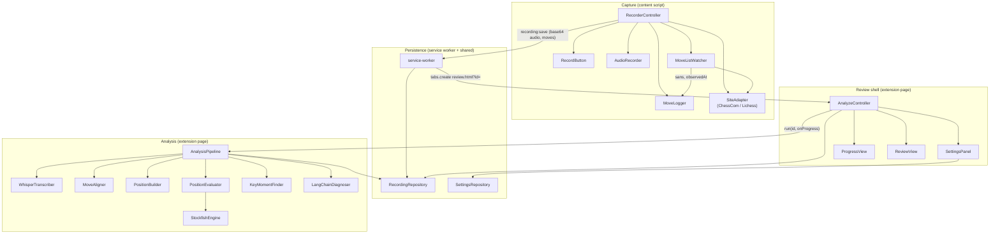

# Component design

Detailed, per-component breakdown of [`../architecture.md`](../architecture.md). Read that first for the overview, decisions and diagrams. This folder says exactly how each piece behaves and how the pieces talk to each other.

## Component map

Arrows mean "calls". Cross-runtime arrows are labelled with what crosses the boundary.

## Index

| # | Section | Classes / modules | Runtime |
|---|---|---|---|
| 01 | [Move capture](01-move-capture.md) | `SiteAdapter`, `ChessComAdapter`, `LichessAdapter`, `normalizeSan`, `MoveListWatcher`, `MoveLogger` | content script |
| 02 | [Audio capture](02-audio-capture.md) | `AudioRecorder` | content script |
| 03 | [Recorder controller](03-recorder-controller.md) | `RecorderController`, `RecordButton`, hotkey | content script |
| 04 | [Persistence and messaging](04-persistence-and-messaging.md) | `service-worker`, `RecordingRepository`, `SettingsRepository`, `base64` | service worker + shared |
| 05 | [Review shell](05-review-shell.md) | `AnalyzeController`, `SettingsPanel`, `ProgressView`, `ReviewView`, `el()` | review page |
| 06 | [Transcription and alignment](06-transcription-and-alignment.md) | `WhisperTranscriber`, `dropNonSpeech`, `MoveAligner` | review page |
| 07 | [Position evaluation](07-position-evaluation.md) | `PositionBuilder`, `StockfishEngine`, `PositionEvaluator`, `score` | review page |
| 08 | [Key moments](08-key-moments.md) | `KeyMomentFinder`, `chessUtil` | review page |
| 09 | [Diagnosis](09-diagnosis.md) | `PromptBuilder`, `LangChainDiagnoser`, `DiagnosisParser` | review page |
| 10 | [Pipeline](10-pipeline.md) | `AnalysisPipeline`, `AnalysisError`, `config` | review page |
| - | [Interactions](interactions.md) | cross-cutting: import rules, call matrix, data ownership, clocks, error flow | all |

## Section template

Every section uses the same headings: **Purpose**, **Contract** (TypeScript signatures), **Collaborators** (who calls it, what it calls), **Behaviour** (algorithm, states, diagrams), **Edge cases**, **Errors**, **Tests**.

## Changes vs. the current skeleton

Working these details out changed some signatures and types. The stubs under `src/` have **not** been updated yet. Apply these before implementing:

| # | Change | File(s) |
|---|---|---|
| 1 | Watcher handler becomes `(sans, observedAt)`. The watcher is the only code that reads the clock for moves. No debounce, because `MutationObserver` already batches. A 500 ms heartbeat re-attaches a replaced or late-mounted root. | `MoveListWatcher.ts` |
| 2 | New pure module `normalizeSan`, shared by both adapters. | `content/adapters/normalizeSan.ts` |
| 3 | `MoveLogger` never shrinks on a *shorter* snapshot (transient blank re-renders). It only truncates on divergence. | `MoveLogger.ts` |
| 4 | `AudioRecorder` gets `onLost(cb)` and typed errors `MicDeniedError`, `NoMicError`, `UnsupportedAudioError`. | `AudioRecorder.ts` |
| 5 | Analysis cache moves to **one storage key per stage**, so the parallel stages can't lose each other's writes. `RecordingRepository.get` assembles `Recording.analysis`. The stored shape is `RecordingMeta = Omit<Recording, 'analysis'>`. | `RecordingRepository.ts`, `types.ts` |
| 6 | The cached transcript is the **raw** Whisper segments. The no-speech filter runs at use time, so the threshold can change without re-transcribing. | `AnalysisPipeline.ts` |
| 7 | `ProgressEvent` replaces `(stage, done, total)`. | `AnalysisPipeline.ts`, `ProgressView.ts` |
| 8 | New `analysis/errors.ts`: `AnalysisError(stage, kind, message)`. Kinds: `config`, `auth`, `too_large`, `network`, `permission`, `parse`, `engine`, `unsupported`. | new file |
| 9 | `PositionBuilder.build` returns `{ positions, illegalAtPly }`. | `PositionBuilder.ts` |
| 10 | `KeyMomentFinder.find` also takes `positions`, for `fenBefore` and canonical SAN. | `KeyMomentFinder.ts` |
| 11 | `Diagnoser.diagnose(moments, color)` takes the colour. `Diagnosis` gains optional `warnings`. `ReviewResult` gains `warnings` and nullable `summary` and `habit`, for the no-key-moments case. | `AnalysisPipeline.ts`, `types.ts` |
| 12 | The pipeline evaluates only positions from `firstTimedUserPly - 1` onward, so a mid-game join doesn't waste engine time. | `AnalysisPipeline.ts` |
| 13 | New `analysis/config.ts` holds all tunables. | new file |
