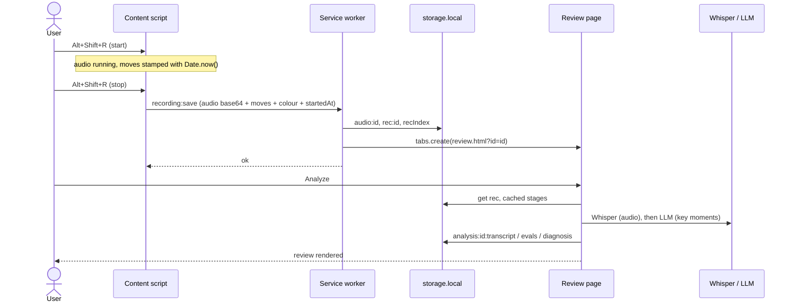
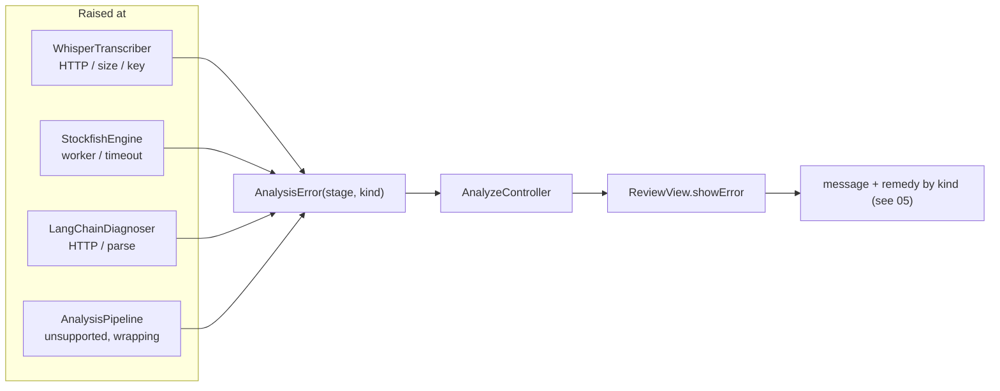

# Interactions

Cross-cutting rules and the contracts between components. Each component's own behaviour is in sections 01 to 10. This file is the answer to "who is allowed to talk to whom, and what happens when something goes wrong".

## 1. Who may import whom

| Folder | May import | Must NOT import |
|---|---|---|
| `shared/` | nothing from other src folders | everything else |
| `content/` | `shared/` only | `analysis/`, `review/`, `background/`, chess.js, Stockfish, LangChain |
| `background/` | `shared/` | `content/`, `analysis/`, `review/` |
| `analysis/` | `shared/` | `content/`, `review/`, `background/` |
| `review/` | `shared/`, `analysis/` | `content/`, `background/` |

The `content/` rule is the hard constraint (no help during a game) enforced by structure. The content-script bundle contains no engine, no chess library and no LLM client, so it can't analyse a position even by mistake.

The `analysis/` to `review/` rule prevents cycles. That is why `Stage`, `ProgressEvent` and the other cross-folder types live in `shared/types.ts` or `analysis/`, never in a view file.

## 2. Call matrix

| Caller | Callee | Call | Sync? | Failure mode |
|---|---|---|---|---|
| `main.ts` (content) | adapter factory | pick by `location.hostname` | sync | unknown host means no controller is built |
| `RecorderController` | `SiteAdapter` | `userColor()`, `readMoves()` | sync | returns `null` or `[]`, never throws |
| `RecorderController` | `AudioRecorder` | `start()`, `stop()`, `onLost()` | async | typed errors from `start()` |
| `RecorderController` | `MoveListWatcher` | `start(handler)`, `stop()` | sync | handler errors are caught and logged |
| `MoveListWatcher` | `SiteAdapter` | `moveListRoot()`, `readMoves()` | sync | `null` or `[]` |
| watcher handler | `MoveLogger` | `onSnapshot(sans, at)` | sync | total |
| `RecorderController` | service worker | `sendMessage(recording:save)` | async | `{ok:false}`, no response, or rejection, all treated as a save failure |
| service worker | `RecordingRepository` | `save(payload)` | async | rejects, becomes `{ok:false}` |
| service worker | `chrome.tabs` | `create(review.html?id)` | async | logged only |
| `AnalyzeController` | `RecordingRepository` / `SettingsRepository` | `get` | async | `null` means "not found" |
| `AnalyzeController` | `AnalysisPipeline` | `run(id, onProgress, opts)` | async | throws `AnalysisError` |
| `AnalysisPipeline` | `RecordingRepository` | `get`, `getAudio`, `saveStage` | async | rejects, wrapped as `AnalysisError` |
| `AnalysisPipeline` | `Transcriber` | `transcribe(blob)` | async | `AnalysisError('transcribe', …)` |
| `AnalysisPipeline` | `PositionBuilder` | `build(sans)` | sync | `illegalAtPly` instead of throwing |
| `AnalysisPipeline` | `PositionEvaluator` | `evaluateAll(subset, cb)` | async | `AnalysisError('evaluate','engine')` |
| `PositionEvaluator` | `StockfishEngine` | `init`, `analyse`, `dispose` | async | rejects on timeout or worker error |
| `AnalysisPipeline` | `MoveAligner`, `KeyMomentFinder` | `align`, `find` | sync | total functions |
| `AnalysisPipeline` | `Diagnoser` | `diagnose(moments, color)` | async | `AnalysisError('diagnose', …)` |
| `LangChainDiagnoser` | `PromptBuilder`, `DiagnosisParser` | `build`, `parse` | sync | `parse` throws `DiagnosisParseError` |
| `AnalyzeController` | `ReviewView` | `render(result)`, `showError(e)` | sync | none |

## 3. End-to-end timeline

## 4. Data ownership

| Data | Created by | Changed by | Stored in | Read by |
|---|---|---|---|---|
| `RecordingPayload` (message) | `RecorderController` | nobody | not stored (in flight) | service worker |
| `RecordingMeta` (+ `moves`) | `RecordingRepository.save` | nobody (immutable) | `rec:{id}` | pipeline, controller |
| audio | `RecordingRepository.save` | nobody | `audio:{id}` | pipeline (Whisper only) |
| raw transcript | `WhisperTranscriber` | nobody | `analysis:{id}:transcript` | pipeline |
| evals | `PositionEvaluator` | nobody | `analysis:{id}:evals` | pipeline |
| diagnosis | `LangChainDiagnoser` | replaced by Re-diagnose | `analysis:{id}:diagnosis` | pipeline |
| `AlignedMove[]`, `KeyMoment[]`, `ReviewResult` | pipeline | nobody | **not stored** (recomputed) | `ReviewView` |
| `Settings` | `SettingsPanel` | `SettingsPanel` | `settings` | `AnalyzeController`, via `createPipeline` |

A recording is **write-once**. All later writes are additive analysis keys. That is why no read-modify-write races exist.

## 5. Clocks

- Every absolute time (`startedAt`, each `observedAt`) is `Date.now()` taken **inside the content script**: the audio start in the recorder's start event, each move in the watcher. One process, one clock, no skew.
- Whisper times are seconds relative to the audio start. `MoveAligner` is the only place that converts them (`startedAt + start * 1000`).
- `durationMs` is `Date.now() - startedAt` at stop. It is informational and not used for alignment.
- The service worker and review page never stamp times that matter to the analysis.

## 6. Error flow

Capture-side failures never reach the review page. They surface as the record button's error or `save_failed` state, and the unsaved payload stays in memory for retry.

## 7. Security and privacy rules

- **Render as text.** All model output and transcript text goes through `el()` and `textContent`. `innerHTML` is lint-banned.
- **Prompt injection.** Transcript text is passed as a labelled data field, and the fixed rules say it isn't instructions. The worst case is a wrong label, because the model has no tools and its output is validated.
- **Message trust.** The only runtime message is `recording:save`, from our own content script. The service worker validates its shape. No `externally_connectable`.
- **Keys** live in `storage.local`, in plaintext, extension-private. They are sent only to the Whisper host and the user's chosen LLM host.
- **Data leaving the machine:** audio goes to OpenAI. FENs, moves, evals and transcript excerpts go to the configured LLM host. The settings page should state this.
- **No in-game output beyond the record button.** The content bundle can't analyse, and the button shows only state and elapsed time.
